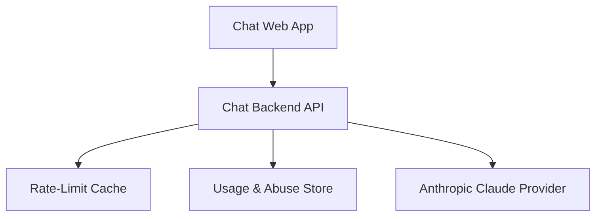
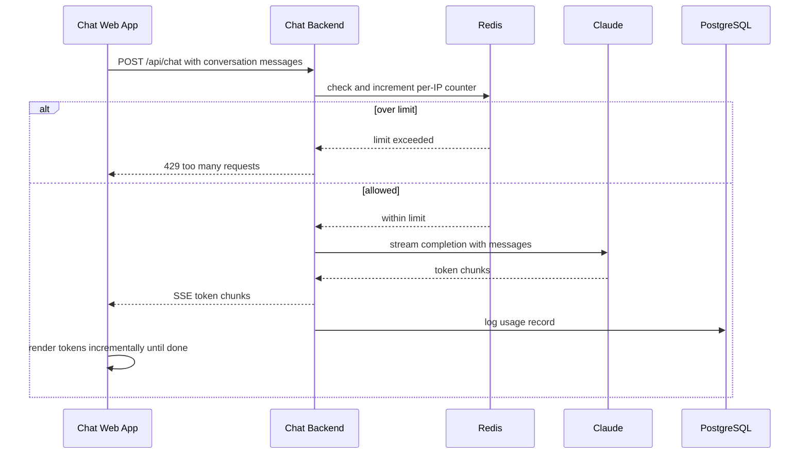
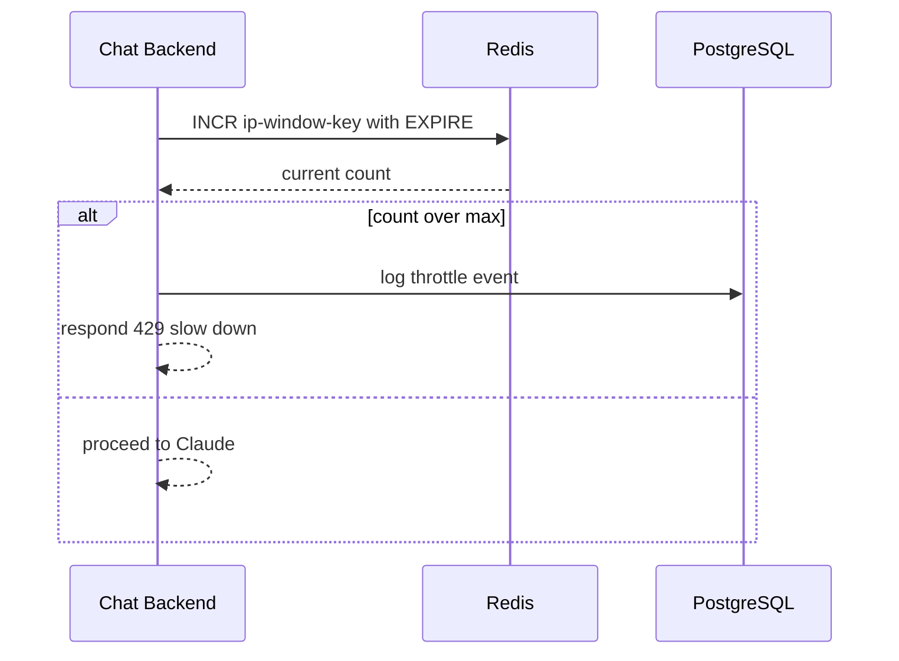
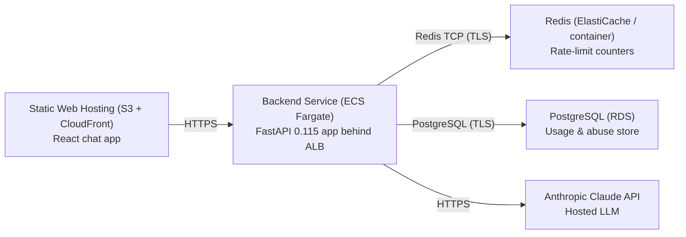

# Architecture

> Maintained by QuorQ AI SDLC. Text between `sdlc:auto` markers is regenerated; anything outside them is yours and is kept.

<!-- sdlc:auto:start narrative -->
## Overview

### ARCH-001 · approved · source: architecture:summary

Overall system is a lightweight, no-login chatbot: React UI keeps conversation in browser session storage and streams replies live; FastAPI backend relays conversation to Anthropic Claude, streams tokens back, and enforces per-IP rate limiting via Redis to control cost. PostgreSQL stores only rate-limit/usage/abuse records, no per-user chat history anywhere.

Approved architecture, version 1. Scope: single-screen chat app with no login and no persisted per-user conversation history. Frontend (React 19) holds the conversation client-side in session storage and renders Claude's streamed reply incrementally. Backend (FastAPI 0.115) relays the full conversation sent by the client to Anthropic Claude, streams tokens back token-by-token, enforces per-IP rate limiting, and logs basic usage/abuse. Redis provides fast in-memory per-IP counters with TTL windows; PostgreSQL 16 durably stores rate-limit audit records and anonymized usage/abuse logs only. Entire system deployed on AWS at modest scale with room to grow.

- ⚠ Input does not explicitly map any component, critical path, or entity to specific requirement ids (US-001..US-009); requirement-level traceability for architecture decisions could not be derived from this input.

### ARCH-002 · approved · source: architecture:components:web_ui

Chat Web App is the responsive, ChatGPT-style single-screen frontend built in React 19.

Holds the entire conversation in browser session storage (no server-side chat history). Renders the assistant's streamed reply incrementally as tokens arrive. Supports starting a new conversation. Shows clear errors to the user while keeping the UI usable after a failure.

### ARCH-003 · approved · source: architecture:components:api

Chat Backend API (FastAPI 0.115) is the relay between the browser and Anthropic Claude.

Receives the full conversation (including prior session messages sent by the client) from the frontend, forwards it to Anthropic Claude, and streams the reply back to the UI token-by-token. Enforces per-IP rate limiting (via the Redis rate store) before forwarding to Claude. Logs basic usage/abuse data to PostgreSQL. Does not persist any chat history.

**Related:** ARCH-002, ARCH-005, ARCH-004

### ARCH-004 · approved · source: architecture:components:rate_store

Rate-Limit Cache is a Redis (redis:7-alpine) store used purely for fast per-IP throttling.

Counts chat requests per IP in-memory. Uses short-lived counters with TTL windows to bound each rate-limit window. Backs the per-IP rate limiting critical path for the Chat Backend API.

**Related:** ARCH-003

### ARCH-005 · approved · source: architecture:components:usage_db

Usage & Abuse Store is a PostgreSQL 16 database for durable, non-conversational server-side records.

Stores rate-limit audit records and basic anonymized usage/abuse logging. Explicitly does not retain any per-user conversation content.

**Related:** ARCH-003

### ARCH-006 · approved · source: architecture:components:llm

Anthropic Claude Provider is the hosted LLM that generates the assistant's replies.

External SaaS API (Anthropic Claude) that receives the forwarded conversation from the backend and generates a streamed plain-text assistant reply.

**Related:** ARCH-003

### ARCH-007 · approved · source: architecture:critical_paths:Send message and stream reply

Primary user flow: submit a message and receive the assistant's reply streamed live.

User submits a message in the UI; client posts the full session conversation to the backend; backend checks the per-IP rate limit (Redis), forwards the conversation to Claude, and streams tokens back to the UI, which renders them incrementally. On a missing API key or provider failure, a clear error is returned and the UI remains usable.

**Related:** ARCH-002, ARCH-003, ARCH-006, ARCH-004

### ARCH-008 · approved · source: architecture:critical_paths:Per-IP rate limiting

Throttling flow that protects the open bot from excessive per-IP usage.

Each chat request increments a TTL-bounded counter for the caller's IP in Redis. If the request exceeds the window limit, it is rejected with a clear throttle message to the user. Once the time window resets, sending messages resumes normally.

**Related:** ARCH-004, ARCH-003

### ARCH-009 · approved · source: architecture:entities

Two data entities back the rate-limit and usage/abuse logging functions; no conversation content is modeled.

rate_limit_event: id, ip_hash, window_start, request_count, throttled, created_at -- records per-IP rate-limit windows and throttle outcomes. usage_log: id, ip_hash, status, input_tokens, output_tokens, error_code, created_at -- records anonymized usage and error/abuse data per request. Both entities use ip_hash rather than raw identifiers, consistent with the no-login, no-chat-history design.

**Related:** ARCH-005, ARCH-004

### ARCH-010 · approved · source: architecture:endpoints

Two backend endpoints: the chat relay/stream endpoint and a health check.

POST /api/chat -- accepts the current conversation (user message plus prior messages from the browser session) and returns the assistant's reply as a streamed plain-text (SSE) response from Claude; enforces per-IP rate limiting. GET /api/health -- liveness/readiness check reporting status of the backend, Redis, and Claude configuration.

**Related:** ARCH-003, ARCH-006, ARCH-004

### ARCH-011 · approved · source: architecture:deployment_nodes

Deployment topology spans AWS static hosting, a containerized backend service, managed cache, managed database, and the external Claude API.

Static Web Hosting (S3 + CloudFront): serves the React chat app as static assets via CDN. Backend Service (ECS Fargate): runs the FastAPI 0.115 app behind an ALB in a Python 3.12 container served by uvicorn. Redis (ElastiCache / container): hosts rate-limit counters using redis:7-alpine. PostgreSQL (RDS): hosts the usage & abuse store on PostgreSQL 16. Anthropic Claude API: external hosted SaaS LLM, not operated by this deployment.

**Related:** ARCH-002, ARCH-003, ARCH-004, ARCH-005, ARCH-006

### ARCH-012 · approved · source: architecture:technology_decisions

Four core technology choices were made and recorded with alternatives considered: React 19, FastAPI 0.115, PostgreSQL 16, and AWS.

Frontend: React 19 chosen (alternatives considered: Vue, Svelte) to drive the single-screen responsive chat UI, keep conversation in browser session storage, and render Claude's streamed tokens incrementally via the fetch streaming API. Backend: FastAPI 0.115 chosen (alternatives: Node/Express, Django) to forward conversations, stream replies via StreamingResponse/SSE, enforce per-IP rate limiting, and for Python-first fit with the Anthropic SDK. Database: PostgreSQL 16 chosen (alternatives: MySQL, DynamoDB) as the durable home for the small server-side footprint (rate-limit audit + anonymized usage/abuse logs), with headroom to add saved history later if accounts are introduced. Cloud: AWS chosen (alternatives: GCP, Azure) using CloudFront/S3 for the static frontend, Fargate behind an ALB for the streaming backend, ElastiCache Redis, and RDS PostgreSQL, for reliability at modest scale with low ongoing cost and room to scale out.

**Related:** ARCH-002, ARCH-003, ARCH-005, ARCH-011
<!-- sdlc:auto:end narrative -->

<!-- sdlc:auto:start building-blocks -->
## Building Block View

| ID | Name | Technology | Responsibility | Depends on |
|---|---|---|---|---|
| web_ui | Chat Web App | React 19 | Responsive ChatGPT-style chat screen. Holds conversation in browser session storage, renders streamed replies incrementally, supports starting a new conversation, and shows clear errors while staying usable. | api |
| api | Chat Backend API | FastAPI 0.115 | Relays the conversation (including prior session messages sent by the client) to Anthropic Claude, streams the reply back token-by-token, enforces per-IP rate limiting, and logs basic usage/abuse. No chat history persisted. | rate_store, usage_db, llm |
| rate_store | Rate-Limit Cache | Redis (redis:7-alpine) | Counts chat requests per IP in-memory for fast per-IP throttling and holds short-lived counters with TTL windows. | — |
| usage_db | Usage & Abuse Store | PostgreSQL 16 | Durable store for rate-limit audit records and basic anonymized usage/abuse logging. No per-user conversation content retained. | — |
| llm | Anthropic Claude Provider | Anthropic (Claude) API | Hosted LLM that generates streamed plain-text assistant replies from the forwarded conversation. | — |

<!-- sdlc:auto:end building-blocks -->

<!-- sdlc:auto:start runtime -->
## Runtime View

### Send message and stream reply

User submits a message; the client posts the full session conversation; backend checks the per-IP rate limit, forwards to Claude, and streams tokens back to the UI which renders them incrementally. On missing key or provider failure a clear error is returned and the UI stays usable.

- **Components:** web_ui, api, rate_store, usage_db, llm
- **Modules:** chat_screen, stream_client, chat_router, rate_limiter, claude_client, usage_logger
- **Key functions:** sendMessage(conversation, text), consumeStream(response), post_chat(request, messages), check_and_increment(ip), stream_claude(messages), log_usage(ip, status)

### Per-IP rate limiting

Each chat request increments a TTL-bounded counter for the caller IP in Redis. Over the window limit the request is rejected with a clear throttle message. Once the window resets, sending resumes.

- **Components:** api, rate_store, usage_db
- **Modules:** rate_limiter, chat_router, usage_logger
- **Key functions:** client_ip(request), check_and_increment(ip, window, max), raise_throttled(), log_throttle(ip)

<!-- sdlc:auto:end runtime -->

<!-- sdlc:auto:start deployment-view -->
## Deployment View

| Name | Service | Runtime | Scaling | Environment |
|---|---|---|---|---|
| Static Web Hosting (S3 + CloudFront) | React chat app | Static assets (CDN) | CDN edge, auto | dev |
| Backend Service (ECS Fargate) | FastAPI 0.115 app behind ALB | Python 3.12 container (uvicorn) | 1 task dev, horizontal autoscale on CPU/requests | dev |
| Redis (ElastiCache / container) | Rate-limit counters | redis:7-alpine | single node dev | dev |
| PostgreSQL (RDS) | Usage & abuse store | PostgreSQL 16 | single instance dev | dev |
| Anthropic Claude API | Hosted LLM | SaaS (external) | managed by provider | dev |

| Source | Target | Protocol |
|---|---|---|
| Static Web Hosting (S3 + CloudFront) | Backend Service (ECS Fargate) | HTTPS |
| Backend Service (ECS Fargate) | Redis (ElastiCache / container) | Redis TCP (TLS) |
| Backend Service (ECS Fargate) | PostgreSQL (RDS) | PostgreSQL (TLS) |
| Backend Service (ECS Fargate) | Anthropic Claude API | HTTPS |

<!-- sdlc:auto:end deployment-view -->

<!-- sdlc:auto:start decisions -->
## Architecture Decisions

| Layer | Choice | ADR |
|---|---|---|
| Frontend | React 19 | [ADR-0001](adr/frontend.md) |
| Backend | FastAPI 0.115 | [ADR-0002](adr/backend.md) |
| Database | PostgreSQL 16 | [ADR-0003](adr/database.md) |
| Cloud | AWS | [ADR-0004](adr/cloud.md) |
<!-- sdlc:auto:end decisions -->

<!-- sdlc:auto:start links -->
## Related Documents

- [Data Model](data-model.md)
- [API Specification](api/openapi.yaml)
- [Architecture Decision Records](adr/README.md)
<!-- sdlc:auto:end links -->
