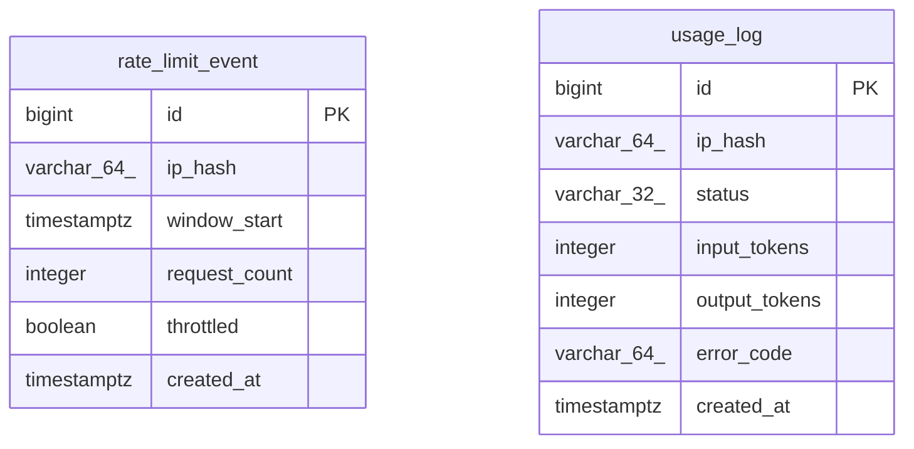

# Data Model

<!-- sdlc:auto:start entities -->
### rate_limit_event

| Field | Type | PK | FK | Nullable |
|---|---|---|---|---|
| id | bigint | True | — | False |
| ip_hash | varchar(64) | False | — | False |
| window_start | timestamptz | False | — | False |
| request_count | integer | False | — | False |
| throttled | boolean | False | — | False |
| created_at | timestamptz | False | — | False |

### usage_log

| Field | Type | PK | FK | Nullable |
|---|---|---|---|---|
| id | bigint | True | — | False |
| ip_hash | varchar(64) | False | — | False |
| status | varchar(32) | False | — | False |
| input_tokens | integer | False | — | True |
| output_tokens | integer | False | — | True |
| error_code | varchar(64) | False | — | True |
| created_at | timestamptz | False | — | False |
<!-- sdlc:auto:end entities -->

<!-- sdlc:auto:start relationships -->
_No relationships recorded._
<!-- sdlc:auto:end relationships -->

<!-- sdlc:auto:start er-diagram -->

<!-- sdlc:auto:end er-diagram -->
