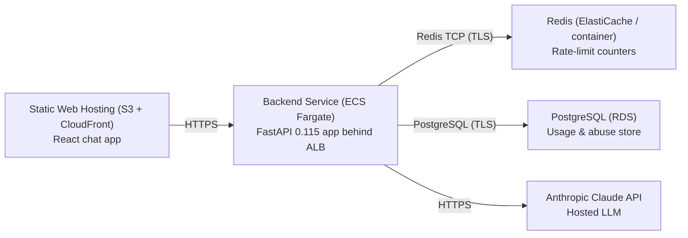

# Deployment Guide

> Maintained by QuorQ AI SDLC. Text between `sdlc:auto` markers is regenerated; anything outside them is yours and is kept.

<!-- sdlc:auto:start how-it-deploys -->
Pushes to `main` run `.github/workflows/deploy.yml`, which builds the API image (if there is a backend) and deploys the SPA to AWS Amplify. Commits touching only `docs/sdlc/**` don't deploy. Deployments can also be started from the platform's Deployment tab.
<!-- sdlc:auto:end how-it-deploys -->

<!-- sdlc:auto:start environments -->
| Name | Service | Runtime | Scaling | Environment |
|---|---|---|---|---|
| Static Web Hosting (S3 + CloudFront) | React chat app | Static assets (CDN) | CDN edge, auto | dev |
| Backend Service (ECS Fargate) | FastAPI 0.115 app behind ALB | Python 3.12 container (uvicorn) | 1 task dev, horizontal autoscale on CPU/requests | dev |
| Redis (ElastiCache / container) | Rate-limit counters | redis:7-alpine | single node dev | dev |
| PostgreSQL (RDS) | Usage & abuse store | PostgreSQL 16 | single instance dev | dev |
| Anthropic Claude API | Hosted LLM | SaaS (external) | managed by provider | dev |
<!-- sdlc:auto:end environments -->

<!-- sdlc:auto:start live -->
_Not deployed yet._
<!-- sdlc:auto:end live -->

<!-- sdlc:auto:start topology -->

<!-- sdlc:auto:end topology -->
